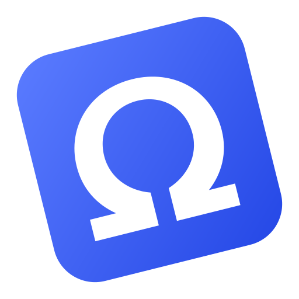
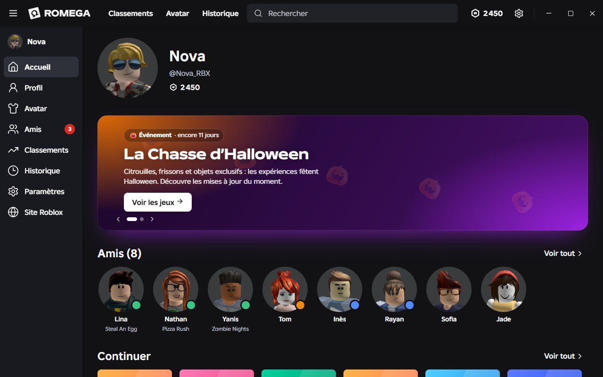

<div align="center">
  

  # Romega — composants web

  **Ton Roblox. Tes règles.**

  Site vitrine et système sécurisé d’annonces du launcher Romega.

  [](https://romega.online)
  [](https://romega.online/admin)

  
</div>

## Contenu de ce dépôt

Cette version publique contient uniquement les **composants web** du projet :

- le site vitrine responsive ;
- les pages de confidentialité et de conditions d’utilisation ;
- l’interface privée de gestion des annonces ;
- l’API Python et son service systemd ;
- les tests du backend d’administration.

Le code du launcher et celui de l’extension ne sont pas inclus dans cette édition publique.

## Site web

Le site est réalisé en HTML, CSS et JavaScript, sans framework ni dépendance à installer.

```bash
python -m http.server 5180 --directory website
```

Ouvre ensuite `http://localhost:5180`.

Les boutons de téléchargement utilisent les releases GitHub configurées dans `website/main.js`.

## Administration des annonces

L’administration permet de créer, modifier, supprimer et publier les annonces affichées sur l’accueil du launcher.

- interface : `/admin` ;
- flux JSON public : `/annonces.json` ;
- API locale : `127.0.0.1:8787` ;
- empreinte du mot de passe : **scrypt** ;
- sessions : cookies `HttpOnly`, `Secure` et `SameSite=Strict` ;
- protections : limitation des tentatives, contrôle de l’hôte et de l’origine, validation des données et écriture atomique.

Le mot de passe et l’empreinte ne doivent jamais être ajoutés au dépôt. Ils sont créés sur le serveur avec :

```bash
sudo python3 /opt/romega-admin/set_admin_password.py
```

### Tests

```bash
cd admin-backend
python -m unittest -v
```

L’API utilise uniquement la bibliothèque standard de Python.

## Structure

```text
Romega/
├── website/            Site vitrine et interface d’administration
├── admin-backend/      API, service systemd, annonce initiale et tests
├── .gitignore          Exclusion des secrets et fichiers temporaires
└── LICENSE             Licence et notices
```

## Déploiement et sécurité

- Le backend ne doit écouter que sur `127.0.0.1`.
- Caddy reste responsable des ports publics `80` et `443`.
- Le fichier `/etc/romega-admin.env` doit rester sur le serveur avec des permissions restreintes.
- Ne commit jamais de mot de passe, jeton, cookie ou clé privée.
- La configuration Caddy fournie est un exemple pour Romega.

> **Serveur mutualisé :** ne remplace jamais le Caddyfile complet par l’exemple. Sauvegarde la configuration et modifie uniquement le bloc du site concerné afin de préserver les autres sites.

## Licence et crédits

Les notices de licence et les crédits sont disponibles dans [`LICENSE`](LICENSE). Le projet conserve les mentions requises par les composants distribués sous GPL.

La police Anton est distribuée sous licence **SIL Open Font License**.

Romega est un projet indépendant. Il n’est affilié ni approuvé par **Roblox Corporation**, **RoValra**, **Sober** ou **Vinegar**. Roblox est une marque de Roblox Corporation.
